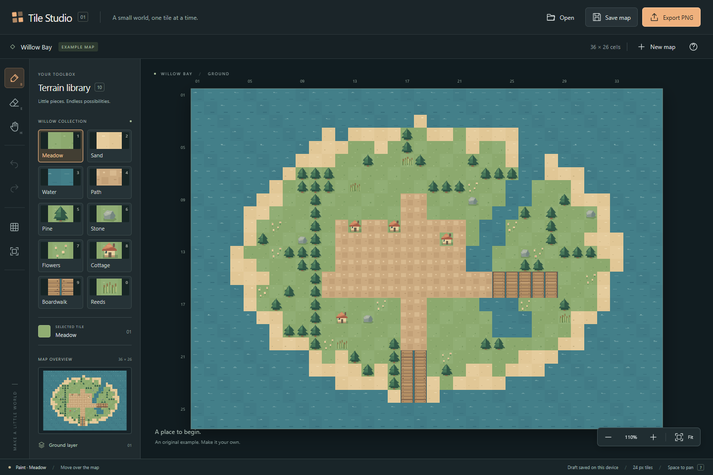

# Tile Studio

**A small world, one tile at a time.**

A compact, offline tile-map editor for sketching outdoor game levels. Paint an island, build a village, and export your world. No accounts, setup, or uploads.



## Start creating

Download this repository as a ZIP, extract it, and double-click **[demo/index.html](demo/index.html)** in Microsoft Edge. The compiled editor is one self-contained HTML file. It runs directly from disk without npm, a server, or an internet connection.

The first screen opens **Willow Bay**, an original, editable example. Choose a tile from the Willow collection and drag to paint. **B** paints, **E** erases, and **H** pans. Hold **Space** while dragging for temporary pan; use the wheel to zoom at the pointer. **F** fits the map, and **G** toggles its grid.

- **Undo / Redo** restores whole strokes. Cancel an unfinished stroke with Escape.
- **Save map** downloads a portable, versioned JSON file; **Open** restores it.
- **Export PNG** downloads only the map at its native resolution, with empty cells transparent.
- **New map** starts a fresh world or reopens the example. Unsaved changes require a choice before replacement.
- A local draft restores your map after reload when browser storage is available.

Use **?** for the complete shortcut reference. All buttons support keyboard focus; on a focused canvas, arrows move the editing cursor, Enter paints, and Delete erases. With the Hand tool, arrows pan. The keyboard editing cursor announces its cell coordinates and terrain through a live status region.

## A two-minute tour

1. Select **Pine**, then drag a forest across the island. A fast drag still paints a continuous line.
2. Zoom in, hold Space and drag, and place a **Cottage** next to a path.
3. Undo once to remove that stroke; Redo brings it back.
4. Save map. Open the downloaded JSON; dimensions and every tile are preserved.
5. Export PNG. Pan or change the grid and export again: the image is unchanged.
6. Open `demo/invalid-map.json`. Its unsupported version produces an error and leaves your map intact.
7. Make another edit and reload. Accept the browser's unsaved warning to try local draft recovery.

## Deliberately small

One layer, ten original terrain tiles, and transparent cells. Maps are **8–64 cells per side**, with at most **4,096 cells**. Each tile exports at **24 × 24 pixels**; the largest PNG is 1,536 × 1,536. JSON input is limited to **256 KiB**. Only the documented version 1 schema and tile IDs 0–10 are accepted; older or future versions are rejected explicitly.

History retains up to 100 strokes and 32,768 changed-cell records across undo and redo. History resets when opening or creating a map and does not survive reload. A pointer cancellation, lost capture, window blur, view change, or Escape rolls back an unfinished stroke. Leaving the map breaks interpolation until re-entry.

Browser storage is a convenience, not a backup. Storage may be blocked, full, cleared, or tied to the file's exact location. A visible warning directs you to save JSON when recovery is unavailable. A Save action initiates a download; check your browser's downloads before discarding important work. Multiple tabs do not coordinate their drafts; keep one editing tab per file location.

Desktop mouse and keyboard are the release target. Windows Edge is verified; other browsers, touch/pen hardware, macOS, Linux, and mobile layouts are not verified. No engine integration, layers, selections, simulation, or cloud synchronization is included.

## Development

Node.js 22.18+ and npm are required only to work on source. Use the checked-in lockfile:

```powershell
npm ci
npm run dev
```

The development server listens on `http://127.0.0.1:5173`. Build the ready demo with `npm run build`. See [development and architecture](docs/DEVELOPMENT.md) for state ownership, coordinate transforms, file format, and commands; see [verification](docs/VERIFICATION.md) for observed checks and screenshots.

## License

MIT. The terrain artwork, example map, icons, and interface are original assets included under the same license. There are no runtime packages, embedded fonts, or externally hosted assets. See [third-party notices](THIRD_PARTY_NOTICES.md). The demo contains its license, build provenance, sample files, and SHA-256 checksums.
