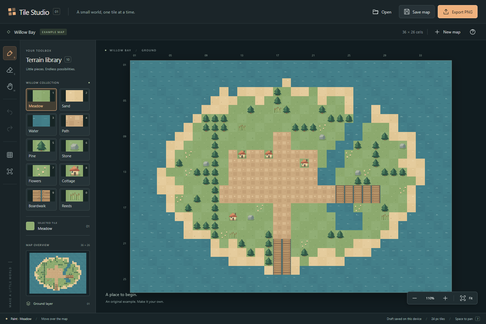
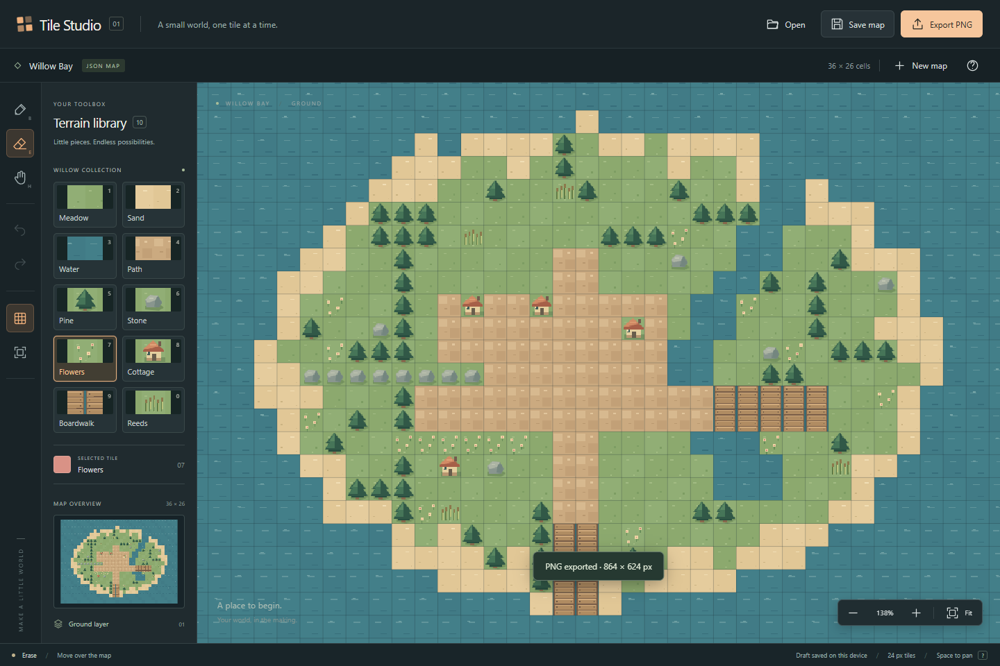
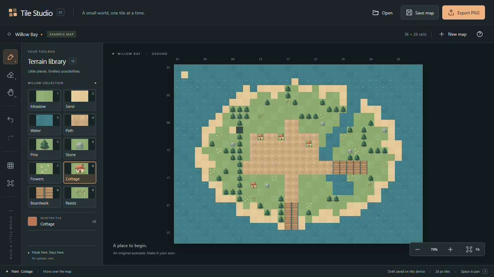
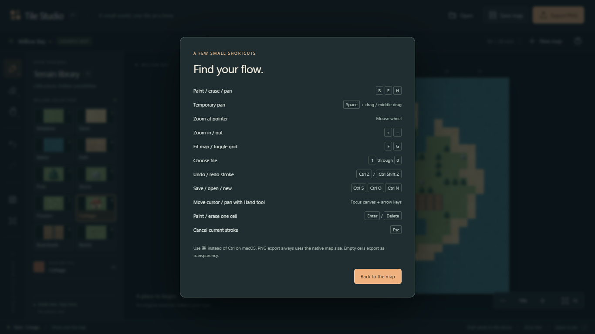

# Verification

Verified on **2026-10-30**, Windows x64, Microsoft Edge **156.0.4314.50**, Node.js **26.13.0**, npm **11.20.0**. Browser checks used the installed Edge channel through Playwright in headless mode. The tested application was the compiled **`demo/index.html` opened with `file://`**, with no server.

## Results

| Check                    | Observed result                                                                                                  |
| ------------------------ | ---------------------------------------------------------------------------------------------------------------- |
| `npm run format:check`   | Passed                                                                                                           |
| `npm run lint`           | Passed, no errors                                                                                                |
| `npm run typecheck`      | Passed, strict TypeScript                                                                                        |
| `npm test`               | 15 domain tests passed                                                                                           |
| `npm run build`          | Self-contained inline HTML, 40,959 bytes                                                                         |
| `npm run verify:package` | 7 package checksums and 16 exact source-input hashes verified                                                    |
| `npm run test:demo`      | 14 browser scenarios passed: 7 at DPR 1 and the same 7 at DPR 2                                                  |
| Browser diagnostics      | No page errors, console errors, failed asset requests, or HTTP(S) requests                                       |
| Visual review            | Packaged first screen, edited map, 1366 × 768 laptop layout, and shortcut dialog inspected as actual screenshots |

## Domain boundaries

The 15 tests cover:

- CSS-pixel transforms across pan/zoom and simulated backing-store scaling; floor behavior at negative/tile boundaries; anchored/clamped zoom; centered fit; gap-free horizontal, steep, diagonal, and reversed interpolation.
- Whole-stroke undo/redo; repeated-cell deduplication; no-op preservation of redo; redo invalidation; cancellation rollback; outside-map re-entry; operation and changed-cell memory budgets.
- Example and maximum-size JSON round-trips; unsupported versions; malformed input; unknown fields; integer dimension/cell constraints; invalid palette IDs; name/tile-size checks; UTF-8 byte limits; ownership of parsed data; validated draft recovery; corrupt, denied, and full storage.

## Packaged browser scenarios

Each scenario runs at both device pixel ratios:

1. **Main workflow:** paint an eight-cell stroke with one delivered move, zoom, Space-drag pan without changing cells, paint again, undo/redo a whole stroke, erase/undo, save a real JSON download, reopen that download, and export PNG. Parsed downloads preserve all cells and dimensions. The 864 × 624 PNG is byte-identical after zoom/grid changes.
2. **Recovery:** invalid version, broken JSON, and a file above 256 KiB preserve the edited map. Reload restores an unsaved draft. Cancelled replacement preserves it; explicit discard opens the supplied example.
3. **Interaction/keyboard:** Escape rolls back an in-progress stroke without a history entry. A new edit invalidates redo. Resizing to 1366 × 768 and fitting preserves edit coordinates. Keyboard movement, terrain selection, painting, erasing, and help work.
4. **New map/export:** an 8 × 10 empty map retains dimensions, exports a 192 × 240 PNG with transparent cells, and follows the Save & continue replacement path with the correct downloaded document.
5. **Storage failure:** a corrupt draft read shows a recoverable warning; an injected quota error keeps JSON saving available.
6. **Wheel/resize/pan:** wheel zoom at a pointer anchor, resize without refitting, and keyboard Hand-tool pan keep subsequent edits on the intended cells. The test uses the wheel delta actually delivered by Edge because injected wheel deltas differ with device scaling.
7. **Pending transaction:** a debounce does not store a partially painted stroke; pointer cancellation removes its preview while retaining the previous committed edit.

## Visual evidence

The first screen labels Willow Bay as an example, shows the complete palette, and keeps the map dominant. The compact layout hides its optional overview to avoid clipping the tools. Focus, selection, disabled history buttons, dialogs, and status feedback use consistent styling.

## Limits of this evidence

These checks verify Windows desktop Edge and synthetic mouse/keyboard input. They do not establish support for other browsers or operating systems, real touch/pen hardware, assistive technologies, browser extensions, or every storage policy. No performance benchmark or deployment is claimed. Browser drafts are file-location-dependent convenience storage, and browser download completion cannot be guaranteed by the Save action. Use JSON files as portable backups.
